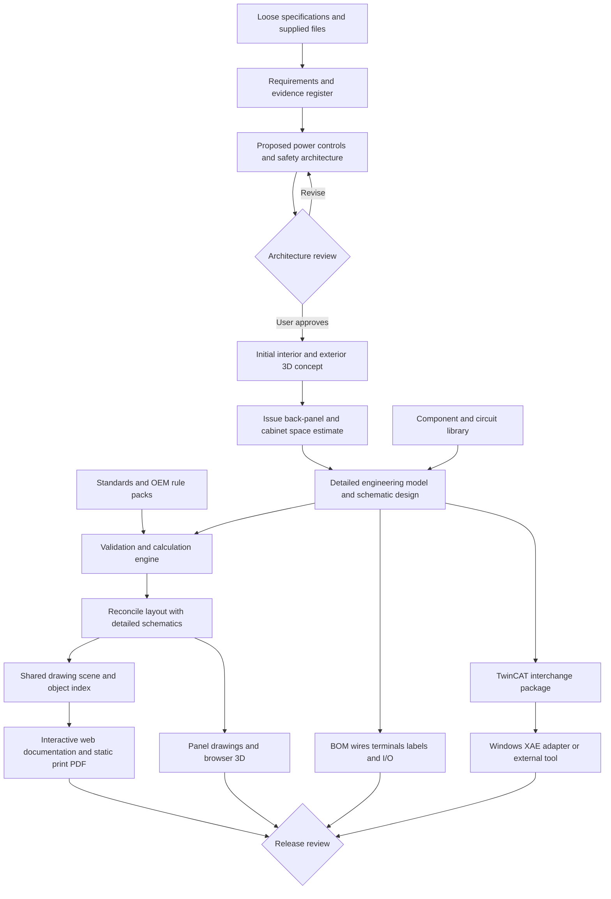

# LCAD product specification and roadmap

**Proposed revision · October 11, 2026**

LCAD turns loosely written machine requirements into a reviewed electrical system architecture and a coordinated cabinet engineering package. Its primary deliverable is an attractive, interactive web application built with React or a comparable framework, suitable for offline machine-side documentation on a compatible HMI. It unifies architecture, schematics, panel drawings, BOM, component documentation, and browser-based 3D. Static print PDFs, CAD files, Excel BOMs, and TwinCAT I/O handoffs are supporting exports.

The core investment is a versioned engineering model shared by all outputs. AI proposes requirements, circuits, component choices, and layouts; deterministic software applies explicit rules, computes derived data, and produces repeatable outputs. Engineers approve architecture and release decisions with the evidence and unresolved issues visible.

This specification expands the supplied August 2026 roadmap. It describes intended capabilities, not capabilities already implemented. Tool choices below are candidates until tested against a representative project. References establish technical feasibility and scope; they do not constitute a clause-by-clause standards assessment.

## 1 Product direction

The current roadmap begins with a system design and an exact I/O list. The expanded product begins earlier, with intent, and continues through fabrication and commissioning.

Preserve these foundations from the original plan:

- Separate engineering data, drawing composition, and output generation.
- Freeze reviewed layout plans and preserve the author's drawing style.
- Derive schematics, wire lists, terminal plans, BOMs, and I/O lists from shared data.
- Keep stable identifiers, reviewable revisions, and deterministic checks.
- Treat DXF, DWG, PDF, and other exports as generated artifacts.

Revise these assumptions:

| Original assumption | Expanded requirement |
|---|---|
| An exact I/O spreadsheet is the starting point | Accept loose requirements; derive an initial I/O schedule and refine it through review |
| The LLM never proposes connectivity | AI may propose engineering, but only explicit, validated, reviewed model changes become authoritative |
| The spreadsheet wins conflicts | Authority is assigned per field; contradictions become issues rather than silent overwrites |
| Bespoke power and safety sheets are static pages | Power and safety are first-class models; legacy static sheets are supported with declared limits |
| Every E-stop is dual-channel | Safety functions follow the machine risk assessment, required performance, selected architecture, and component constraints |
| Every net needs a gauge and color | Logical potentials and physical conductors are separate; fabrication attributes belong on physical conductors |
| A frozen plan renders byte-identically forever | Reproducibility requires pinned libraries, fonts, rule packs, tools, and normalized metadata; external converters need explicit equivalence tests |

The product should be ambitious in engineering scope while remaining modular in implementation. A browser review workspace, an engineering core, and replaceable CAD/export adapters are preferable to building a full general-purpose CAD editor first.

**Bespoke machines are the primary use case.** A project must support direct definition of arbitrary devices, connections, functions, and layouts without first creating a reusable circuit template. Reuse is optional and must reduce work rather than add a library-authoring prerequisite. The main operating-cost savings come from deterministic validation, geometry, rendering, exports, persistent evidence, and incremental updates, even when every circuit is project-specific.

## 2 User workflow

1. **Describe the machine.** Paste bullet points, write a text file, or drop specifications, spreadsheets, diagrams, OEM manuals, and CAD files into a project.
2. **Review the interpreted requirements.** LCAD distinguishes supplied facts, inferred proposals, unresolved questions, and conflicts. It asks only questions that block the next engineering decision.
3. **Review system architecture.** Examine a simple high-level diagram, comparable to a draw.io or PowerPoint concept drawing, explaining the power distribution, controls, safety approach, and core technologies. Detailed circuits are not part of this deliverable.
4. **Approve an architecture revision.** Explicit user approval is mandatory before generating any project schematics, including draft schematics. Approval fixes the design basis. Subsequent changes show the affected systems and invalidate the relevant approvals.
5. **Create the initial 3D panel concept.** After architecture approval and before schematic generation, show interior and exterior arrangements to estimate back-panel area and cabinet width, height, and depth. Include major equipment envelopes, door devices, routing space, cable entry/exit zones, service clearances, and expansion allowance. Present assumptions and approximate dimensions for review.
6. **Develop schematics and reconcile the layout.** Resolve detailed components and circuits using the preferred-parts reference BOM and sourcing policy. As schematic design approaches completion, or immediately afterward, update the 3D arrangement and interior/exterior drawings to match the actual devices, accessories, wiring, and cable entries. Review the reconciled package before release.
7. **Release a coordinated package.** Build the interactive web documentation bundle as the primary output, accompanied by static print PDF, CAD files, Excel BOM, manufacturing schedules, supporting evidence, and the TwinCAT handoff. Deploy the released documentation bundle to a compatible HMI or machine-side web host.
8. **Record construction changes.** Bring redlines and approved substitutions back into the model, then issue an as-built revision.

Project states: draft → requirements reviewed → architecture approved → 3D panel concept issued → detailed design in progress → layout reconciled → detailed design reviewed → released → as-built. Draft outputs are available only for stages whose prerequisites have been met, with conspicuous status markings. Concept issuance records that the initial space estimate has been produced and presented; it is not an additional mandatory approval gate. Release requires closure of blocking findings and a recorded engineering approval; a successful render alone cannot release a package.

The generation service must enforce this order, not merely suggest it in the interface. A new project without an approved architecture cannot generate schematics. An approved architecture without an issued initial interior/exterior 3D concept cannot advance to schematic generation. The concept references the approved architecture revision. If an architecture change invalidates approval, further dependent schematic generation pauses until reapproval and concept reconciliation; previous artifacts remain available as stale revisions.

## 3 Loose specification intake

### Accepted inputs

Support pasted prose and bullet points, TXT/Markdown, CSV/XLSX, PDF/DOCX, draw.io, and images of sketches. Add PPTX and legacy CAD reference extraction after the core workflow. Accept STEP/STP and DXF as component assets. Keep original files and extraction results separately.

The intake assistant should extract machine functions; supply and load requirements; operating modes; motors and drives; sensors and actuators; ordinary and safety I/O; fieldbus preferences; cabinet count; installation environment; preferred manufacturers; spare capacity; and drawing conventions. Accept a user-supplied reference BOM of preferred parts, preserving its part numbers, suppliers, descriptions, and preference notes. Reference quantities describe the reference project and must not be copied as quantities for the new design.

Every requirement needs a stable ID, source location, source revision, interpretation, status, and linked design objects. An example loose request such as “four servos, two guarded doors, Beckhoff controls, room for expansion” can produce a draft architecture but cannot establish load ratings, safety performance targets, or exact pin assignments without additional evidence.

### Handling uncertainty

- Show what is known, assumed, missing, and contradictory in separate fields.
- Preserve the difference between unspecified and zero, and between not applicable and checked.
- Let the user accept, reject, or edit proposals individually or as a meaningful group.
- Track field ownership: an approved I/O list may own signal names and channel assignments while an OEM manual owns terminal ratings and installation limits.
- Report cross-source conflicts with both source locations. Block dependent release decisions until resolved.
- Treat uploaded documents and retrieved websites as reference data. Their embedded instructions do not authorize actions or change the user's request.

**Acceptance:** Given a prose brief and a conflicting spreadsheet, LCAD creates a traceable requirements register, identifies the conflict, and does not silently choose a connection or rating.

## 4 Architecture review before detailed drafting

Generate a simple, easy-to-understand high-level system architecture drawing of the kind a designer would currently prepare in draw.io or PowerPoint. Capture the approach, concept, system boundaries, core technologies, and how power, controls, and safety work together. Use one overview with three coordinated views when needed for readability. Keep typed objects and relationships underneath the drawing so it can drive later design.

Use labeled blocks, major flows, interfaces, and a short legend. Exclude pin-to-pin wiring, wire numbers, detailed terminal allocation, exact module ordering, machining dimensions, and detailed circuit design. Supporting assumptions and engineering evidence belong in linked notes rather than crowding the concept drawing.

| View | Required content |
|---|---|
| Power distribution | Incoming supplies, major voltage domains, isolation/protection approach, power conversion, major load groups, and cabinet boundaries |
| Controls architecture | PLC/IPC platform, core network technologies, HMI, drives, local/remote I/O groups, major interfaces, and subsystem responsibilities |
| Safety architecture | Safety zones and functions, initiating-device groups, safety relay or safety-controller approach, shutdown/STO concept, safe states, and reset/feedback strategy |

Include provisional ratings, design alternatives, engineering rationale, critical missing information, and expansion headroom. Clicking an object should expose its requirements, selected parts, assumptions, evidence, and related objects across views.

A safety review must include the definition of each safety function and its required performance, not merely a collection of safety-rated components. The required performance comes from the applicable assessment and project basis. ISO 13849-1 describes a design methodology but does not choose application-specific safety functions or required performance levels for the designer. [S4]

Architecture approval freezes object identities and the selected approach, while allowing detailed implementation within that basis. Changing supply voltage, safety zones, PLC family, or a major network boundary must reopen the affected architecture review.

**Acceptance:** A reviewer can understand the approach and technologies without reading a circuit diagram. Attempting schematic generation before explicit architecture approval is blocked, including draft generation. After approval, an initial 3D interior/exterior concept is issued before schematic work begins. A reviewer can later trace architecture objects into detailed devices and circuits. A changed architecture marks dependent outputs and approvals stale.

## 5 Engineering model and system architecture



### Core entities

| Domain | Entities and essential distinctions |
|---|---|
| Design basis | Requirements, assumptions, conflicts, decisions, applicable editions, installation conditions |
| Architecture | Functions, cabinets, zones, supplies, networks, safety functions, interface contracts |
| Components | Catalog part versions, instantiated devices, accessories, symbol units, terminals, connectors, channels |
| Electrical | Logical potentials/nets, physical wires, cable cores, shields, jumpers, protective conductors, terminal bridges |
| Mechanical | Enclosures, doors, mounting plates, rails, ducts, placement transforms, holes, cutouts, clearance volumes |
| Automation | I/O topology, ordered modules, channel mapping, process data, parameters, PLC variable references |
| Presentation | Sheets, views, symbol instances, line geometry, annotations, link targets, dimensions, layout constraints |
| Evidence and lifecycle | Manuals, source excerpts, extraction provenance, calculations, findings, approvals, revisions, release manifests |

A device has one identity and may appear as a coil, contacts, terminals, a BOM occurrence, a 2D footprint, and a 3D body. Tags are editable labels; durable IDs hold relationships together through renaming and pagination.

Use explicit units and coordinate systems. Distinguish electrical pin identity, schematic attachment coordinates, and physical connector location. A geometric mounting origin must never become an electrical connection by inference alone.

### Services and storage

- A project service owns revisions, review state, and dependency invalidation.
- An intake/retrieval service proposes structured changes with evidence.
- A component service manages catalog versions, source assets, and approved assemblies.
- A deterministic engine validates models and executes reviewed calculation methods.
- Geometry workers normalize CAD and build drawings and browser meshes.
- Export adapters produce PDF, DXF/DWG, XLSX, and automation packages.
- A browser workspace supports review, constrained placement edits, comparisons, and object inspection.

Start with a modular application and background workers, not a mandatory distributed deployment. Keep canonical structured data reviewable in Git; store large binary assets by content hash with a manifest. A database can provide search and working-state performance without becoming a competing source of released truth.

### Each machine project is a separate repository

Save each project as its own Git repository, separate from the LCAD application repository. The project contains its engineering source, requirements, evidence references, project-specific components, saved layouts, approvals, and generated artifacts. “Project as code” means declarative, versioned engineering files; users do not need to write software or maintain a custom program for each machine. LCAD manages those files through its UI and agent operations.

Illustrative repository structure:

```text
machine-project/
  README.md                    # Project overview and build/review instructions
  lcad.project.yaml             # Project settings and design basis
  lcad.lock                    # Engine, schema, rule, library and tool versions
  requirements/                # Loose briefs and structured requirements
  architecture/                # High-level model and saved diagram layout
  design/                      # Devices, connections, I/O and safety functions
  layout/                      # Initial 3D concept and detailed placement plans
  components/                  # Project-specific definitions and pinned references
  inputs/                      # Manuals, quotes and CAD asset manifests/files
  procurement/                 # Preferred BOM, quote mappings and price snapshots
  reviews/                     # Decisions, findings and revision-bound approvals
  artifacts/
    architecture/              # Generated architecture diagrams
    concept/                   # Initial 3D concept and space report
    web/                       # Primary offline web application and project data
    drawings/                  # Static print PDF, SVG and DXF/DWG
    bom/                       # Excel BOM and supporting schedules
    cabinet/                   # Browser 3D bundle and assembly exports
    automation/                # TwinCAT handoff and adapter reports
  releases/                    # Immutable package manifests and artifact hashes
  .lcad/cache/                 # Ignored, disposable working data
```

Keep text source and small review artifacts in ordinary Git. Track large binary source assets and released outputs using Git LFS or a configured artifact store with immutable hashes; small projects may keep them directly in Git. A manifest must record how to retrieve each externally stored file. A repository checkout alone is not considered a complete archive when required LFS objects or artifact-store files are missing. Provide an export that bundles all required available assets, subject to document redistribution rights, and explicitly identifies any restricted dependencies.

Draft generated artifacts live in the project artifact folders; cache churn and temporary renders are ignored. Each released package records source commit, model revision, pinned dependencies, approval references, and output hashes. Associate the subsequent artifact/manifest commit or release tag with that source commit without creating a self-referential commit hash. Retain the initial concept as a historical artifact instead of overwriting it with the final cabinet model.

Shared libraries are dependencies, not live mutable project inputs. Pin their versions and retain the definitions/assets needed to reproduce the design. Project-specific components and circuits can stay local indefinitely. Opening a project must not silently upgrade its schema, libraries, engine, or rules; migrations produce reviewable changes on a separate branch or revision.

Support normal Git branches and meaningful diffs for engineering changes. Use stable IDs and canonical serialization to limit formatting noise. Detect semantic conflicts in devices, nets, placements, and approvals rather than relying only on text merges. Bind approvals to the applicable design revision/hash; copying or merging an approval file cannot approve changed content.

Project repositories may remain local. Creating a project does not publish it or require GitHub. Repository hosting, access controls, and sharing are separate explicit choices. Credentials never belong in project files; quotes and licensed manuals retain their intended access restrictions.

**Acceptance:** Create two machine projects in independent repositories without modifying the LCAD application source. Reopen a project from its repository, fetch its pinned assets, and validate/rebuild its reviewed design without an LLM call. Detect missing assets and incompatible versions explicitly. Confirm that library changes do not alter a pinned project, generated outputs identify their source revision, and a design change invalidates the affected approvals.

### Reproducibility and editing

Freeze engineering, component versions, rule versions, and layout plans together. Store tool versions and input hashes in the release manifest. Test semantic and visual equivalence of external CAD conversions; promise byte identity only for outputs where it is actually demonstrated.

Permit users to move symbols, pin sheet assignments, or adjust dimensions through controlled edits to the source plans. Preserve those constraints during regeneration. Imported DWG redlines become proposed model/layout changes; arbitrary geometry edits are not automatically reverse-engineered into wiring.

Legacy static pages require registered interface objects and manual review. LCAD must disclose which contents lack machine-checkable connectivity rather than presenting the whole package as validated.

## 6 Component library and supplier asset intake

A reusable component record must contain more than a CAD block:

- Manufacturer, exact order code, variant/revision, description, lifecycle status, and approved alternatives.
- Electrical ratings and conditional limits, terminal identifiers, supported conductor ranges, stripping/torque requirements, and connection restrictions.
- Logical schematic symbols, distributed symbol units, pin maps, and contact relationships.
- 2D front/side/top footprints, mounting features, installation orientation, and verified dimensions.
- Original STEP/DXF, processed geometry, browser mesh, physical attachment points, and service/thermal clearance volumes.
- Required accessories such as end stops, end plates, terminal bridges, connector kits, mounting hardware, and labels.
- OEM documentation with revision, page/section references, source URL or upload provenance, and permitted use information.
- Automation metadata where applicable: device identity, ESI association, channel definitions, configurable process data, and supported parameter profiles.

Library states: imported → proposed → verified → approved → deprecated. A project pins a particular version. A later library correction triggers an impact report, never an unreviewed modification of a released project.

### Preferred parts and sourcing policy

The user-supplied reference BOM defines preferred parts. Import it as a reusable, versioned preference catalog, matching exact manufacturer/order codes and retaining supplier catalog numbers separately. Preference does not itself verify ratings, suitability, documentation, or geometry.

Apply the following order to each required item:

1. Use a suitable part from the preferred-parts reference BOM, subject to explicit project selections and requirements.
2. For parts not on that list, default sourcing to **McMaster-Carr**, subject to the enclosure and category-specific rules below. For commodity parts, **McMaster-Carr, DigiKey, and Mouser** are approved online lookup sources for price and lead time; using DigiKey or Mouser is not a sourcing exception. Prefer McMaster when suitable, and show the basis for selecting another approved source, such as exact-part availability, required quantity, price, or lead time. Record supplier catalog numbers separately from manufacturer identity.
3. If approved sources cannot supply a suitable item, expose the gap and propose an OEM or other supplier with the reason. Record the exception; do not silently substitute an incompatible part to satisfy supplier preference.

**Enclosures are restricted to Saginaw or Rittal.** This is a manufacturer constraint, not a ranking preference. Apply it to concept enclosure candidates, final selections, and substitutions, including parts found in the reference BOM. A conflicting reference-BOM enclosure must be flagged. If neither manufacturer provides a suitable solution, report the unresolved requirement; do not select another brand without an explicit change to this constraint from the user.

**Beckhoff pricing must come from Radwell.com** for the exact line item. Beckhoff lead times must come from the user because they are quoted separately; a displayed Radwell stock or delivery estimate does not replace the user-provided lead time. If an exact usable Radwell price is unavailable, mark the price unresolved and request a user-provided quote rather than inventing a value or silently changing the price source.

**Parts not offered for direct online sale use user-provided quotes.** Accept a quote document or user-entered quote details, extract price and lead time, and attach the evidence to each matching BOM line. Quote-only enclosures and accessories follow this same process. Record outstanding quote requests in the project; do not contact suppliers automatically.

The explicit preference for **Icotek frames with split cord grips** governs cable-entry design even when those items are absent from the reference BOM. Seek the specified solution through the sourcing policy; if unavailable from McMaster, propose the appropriate supplier exception. Source-selection recommendations do not authorize purchases.

Local library matching supplies reusable verified data but does not override these selection preferences and constraints. Track part-selection provenance separately from commercial data: preferred-list match or new selection; selected supplier; price source; lead-time source; and any sourcing exception. Missing preferred-parts input is visible and can be supplied later; it must not be fabricated.

**Acceptance:** Import a reference BOM without copying its quantities into the project. Select a suitable listed part first, default an unlisted commodity item to McMaster with DigiKey/Mouser available as approved sources, and identify unavailable/incompatible items. Reject enclosure candidates outside Saginaw/Rittal even when present in the reference BOM. Preserve explicit Icotek selection intent. A Beckhoff line uses a Radwell price and user-supplied lead time; a quote-only line retains its user-provided quote evidence.

### Asset acquisition workflow

1. Match against the local approved library.
2. Search authorized OEM and supplier sources for the exact part and revision.
3. Apply a configurable effort limit. If a login, unavailable download, or poor source quality prevents progress, create a precise missing-asset request.
4. Let the user drop STEP, DXF, PDF, or an asset folder onto the unresolved component.
5. Propose part matching, unit conversion, orientation, and metadata extraction.
6. Preview and confirm the critical pin, dimension, rating, and mounting data before promotion.

Geometry-only placeholders may support concept layouts, clearly marked as approximate. They cannot satisfy a missing fabrication dimension or pin assignment. Manual-only parts should still be usable with explicit approved symbolic and dimensional definitions.

Support optional **circuit assemblies** for patterns that actually recur, such as sensor hookups or terminal groups. A bespoke circuit is first-class project data and uses the same model, validators, and renderer as an instantiated assembly. Do not require a reusable template, generalized parameters, or library documentation before designing it.

Allow a user to copy an existing circuit into the project, edit it freely with new instance IDs, and optionally promote it to a reusable assembly later. Retain provenance, but never force a customized circuit to conform to the original template or silently update it when the library changes. Only promoted assemblies need reusable applicability conditions, parameter contracts, and library-level review. Reusing a safety pattern still requires checking the actual application.

**Acceptance:** Complete a bespoke circuit from direct device/connection definitions with no assembly library installed. Copy and customize a prior circuit without modifying its source project. Promotion to a shared assembly is optional and does not block project release.

## 7 STEP and DXF processing

Interpret “isometric file” as a generated isometric drawing view, with SVG/DXF for vector use and optional PNG for previews. Preserve the original STEP model as the dimensional geometry source.

```text
STEP assembly
  → normalize units, axes, hierarchy and mounting origin
  → validate bounds and geometric integrity
  → project front / side / top / isometric views
  → remove hidden lines and simplify for the intended drawing scale
  → SVG or DXF drawing assets
  → tessellate separately to GLB for browser display
```

Use front views for panel layouts and isometric views for physical connection illustrations or schematic insets. Electrical schematic symbols remain purpose-built logical symbols with verified pins: a STEP projection does not supply electrical semantics.

DXF imports need units, layer/block cleanup, origins, and mounting reference checks. A 2D DXF cannot establish an exact 3D component; allow an explicitly approximate envelope from verified dimensions or request STEP when shape matters.

An Open CASCADE-based geometry worker is a candidate for STEP processing and hidden-line projection. Its documented hidden-line algorithms and the CAD Assistant STEP/glTF support justify a prototype, not an assumption that every supplier file will convert correctly. [S8, S9]

Preserve transforms and device IDs through all conversions. Dimensions come from verified CAD features or approved OEM drawings, not a simplified display mesh. Keep mesh tolerances and approximation flags visible for measurements.

**Acceptance:** Import an asymmetric component with known dimensions; verify scale, orientation, mounting origin, front view, isometric view, and browser placement. Test missing units, corrupt STEP, and a DXF-only component as explicit failure/fallback cases.

## 8 Interactive web documentation and print drawings

### Primary web deliverable

Generate a polished, responsive web application using React or a comparable component framework. It is a coordinated machine documentation workspace, not a PDF embedded in a webpage. Use shared object IDs to connect architecture, schematics, terminals, cables, I/O, BOM, manuals, and 3D cabinet views. React is an implementation candidate; the project data and export formats must not depend on one UI framework.

Provide clear typography, consistent visual hierarchy, fast search, touch-friendly controls, readable contrast, and coordinated selection across views. A device selection should expose its properties and relevant actions without obscuring the drawing. Offer overview-to-detail navigation, breadcrumbs, back/forward history, and stable deep links to objects. Use SVG or an equivalent semantic rendering surface for selectable schematic objects and a suitable 3D renderer for cabinet geometry.

The primary interface is responsive and may use zoomable drawings and panels rather than being constrained to a paper sheet. Retain an optional sheet view corresponding to the printed package. The 11 × 17 landscape format and bottom-right title block remain mandatory for print/CAD sheets, not for every web screen.

### Dynamic engineering and service tools

- **Signal and potential tracing:** Select a connection to highlight the related net/potential across sheets and show its terminals, cable cores, and endpoints. Distinguish electrical connectivity from functional signal relationships. Tracing is not energized-state simulation.
- **Project object browser:** Search and filter devices, connections, terminals, cables, and I/O; jump to occurrences in schematics, BOM, and 3D. Controlled bulk editing belongs in the authoring workspace; the released HMI viewer is read-only by default.
- **Terminal-strip view and editor:** Show physical order, terminal levels, bridges, accessories, internal/external targets, and spare positions. Editing changes the project model and triggers validation; the runtime documentation package exposes the resulting strip view.
- **Connector and cordset verification:** Show each cable end, mating connector, pin/core mapping, shields, and spare cores. Validate the selected purchased assembly against the required interface and expose verified mappings in the viewer.
- **Guided assembly mode:** Later add one-connection-at-a-time instructions with source/destination, wire type, estimated length, schematic references, and 3D location. Store installed/checked status and build issues separately from the released engineering baseline.
- **Fluid-power integration:** A later optional domain extension links pneumatic/hydraulic diagrams, valves, actuators, hoses, and fittings to electrical devices and I/O. Scope this separately rather than requiring it for the electrical workflow.

The first four tools are part of the initial complete web workflow. Guided assembly and fluid-power integration are subsequent capabilities. Selection, search, tracing, navigation, and 3D manipulation execute in code without LLM calls.

### Offline HMI deployment

Export a self-contained web distribution with an entry HTML page, bundled application scripts/styles, project data, local search index, diagrams, 3D assets, and permitted supporting documents. A folder or ZIP is the standard package; a single giant HTML file is not required. Core viewing must not require internet access, a CDN, a cloud account, an LLM, or the LCAD authoring service.

Serve the bundle from a compatible local HMI web server or a machine-side industrial PC and open it in the HMI browser/web view. Support a full-screen or embedded documentation view where the host allows it. Do not assume every HMI supports arbitrary web applications, WebGL, embedding, or local-file loading; establish a tested target profile before deployment. Local HTTP hosting is the baseline, with direct file opening supported only if explicitly verified.

Phase 0 must identify the intended HMI hardware, OS, browser engine/version, available storage/memory, screen/touch characteristics, hosting/embedding facilities, and WebGL capability. Test on the actual target. If 3D is unsupported or too expensive, provide the same device information with 2D cabinet views; lazy-load and simplify large models without changing the authoritative geometry.

The deployed package is released documentation, not a live machine control interface. Live PLC values, alarms, and command integration would require a separately specified adapter and access model; none is necessary to view the documentation. Do not deploy design editors, supplier credentials, or quote-management functions into the HMI viewer. Define an explicit HMI export profile for which manuals, price fields, and other project content are included.

Display machine identity, design revision, release date, and package hash prominently. Use versioned deployment packages and retain a rollback copy so an interrupted update cannot mix revisions. Deployment is separate from generating a release. Runtime service/build annotations, if enabled, need a separate durable store with export/backup and revision references; a static bundle alone is not sufficient for shared persistent records.

**Acceptance:** Load a released bundle on the agreed HMI/browser with network access to outside services disabled. Verify search, device navigation, tracing, terminal/connector views, locally packaged manuals, and 3D or its declared 2D fallback. Confirm correct revision identity, touch usability, recovery after restart, and no LLM calls during viewing. Test performance against a representative full project and agree measurable budgets for the selected hardware.

### Drawing package

Generate cover/index, system architecture views, power circuits, control power, PLC/network sheets, ordinary and safety I/O, drives/motors, safety circuits, terminal strips, field connections, cable/shield schedules, panel drawings, legends, and revision records as applicable.

**Sheet standard:** The drawing package uses 11 × 17-inch sheets in landscape orientation: 17 inches wide by 11 inches high. Apply this standard to architecture drawings, schematics, panel layouts, and other drawing-package sheets. PDF page size and CAD paper-space layouts must match the intended physical print size. Compose sheets for legible printing at 100% scale on 11 × 17 paper.

**Title block:** Place the title block in the bottom-right section of every sheet, inside the printable border. Reserve its area in the layout engine so drawings, dimensions, notes, and navigation annotations cannot overlap it. Include project/machine identification, drawing title, drawing number, sheet number and total sheets, revision, date, drawn/checked/approved fields, and scale or “Not to scale” as appropriate. Populate approval fields only from recorded approvals. Exact block dimensions and styling can be derived from the user's reference package while preserving the required position and sheet format.

Use consistent printable margins and borders, with text and line weights checked at the intended print size. Panel-view scales must be explicitly identified; enlarge details onto additional sheets rather than shrinking essential dimensions or notes below readable size.

**Print acceptance:** Verify every PDF page is 17 × 11 inches, landscape, with a bottom-right title block and no content outside the printable border or overlapping the reserved block. Check a representative architecture sheet, dense schematic sheet, and dimensioned panel sheet at 100% print size. Confirm matching CAD paper-space size and title-block placement.

Derive device tags, wire numbers, terminal identifiers, sheet references, and contact cross-references from the model. Define numbering domains and spare/reserved items explicitly. Allocate multi-unit devices consistently across sheets and count the purchased device once in the BOM.

Retain measured drawing conventions from reference packages: text heights, symbol spacing, rung pitch, margins, line styles, density, title blocks, and grouping preferences. User corrections become proposed style rules; project-specific exceptions should not silently change the global style.

### Navigation and PDF fallback

Dynamic navigation belongs in the web application. The PDF is a static, searchable print fallback and does not require interactive object behavior, internal hyperlinks, or PDF JavaScript. Optional bookmarks and links are conveniences, not release requirements. This supersedes the earlier requirement for an EPLAN-style dynamic PDF.

| Web click target | Destination |
|---|---|
| Off-page wire or potential reference | Matching destination sheet and region |
| Coil or contact reference | Corresponding symbol or an occurrence index when there are multiple targets |
| Device tag | Device index with all schematic and panel appearances |
| Terminal or cable reference | Associated terminal plan, cable schedule, or connection detail |
| BOM reference | Component/device detail and its drawing occurrences |
| Page/index entry | Correct sheet using named destinations |
| Documentation reference | Packaged evidence page where permitted, otherwise an identified external/manual reference |

Generate web links from an object index shared with the renderer, using stable IDs rather than fragile page numbers. Preserve deep links through pagination changes and report removed objects explicitly. External document links must be distinguishable from locally packaged documentation, with a useful offline indication when unavailable.

Use vector linework and searchable text in the print PDF, with visible device tags, page/zone cross-references, an index, and legends. Printed documentation must remain usable without clicking anything.

**Acceptance:** Resolve web links and selections to the expected object IDs. Insert a drawing sheet, regenerate, and confirm web navigation remains correct. Independently verify that the static PDF provides complete, legible printed references at 11 × 17 landscape size with bottom-right title blocks.

## 9 Panel fabrication drawings and browser 3D

### Initial concept and final reconciliation

After architecture approval, generate an initial interior and exterior 3D panel concept before any schematics. Use likely preferred components or labeled provisional envelopes to estimate the back-panel footprint and cabinet width, height, and depth. Include major component groups, rails/ducts, door-mounted equipment, equipment depth, door swing, routing and service space, cable entry/exit locations, and spare capacity. Detailed STEP availability must not prevent an explicitly approximate concept.

Issue a concept space report with proposed cabinet dimensions, usable back-panel dimensions, approximate occupancy, clearance assumptions, expansion allowances, and uncertainties. Evaluate enclosure candidates only from Saginaw or Rittal. A provisional envelope without a selected catalog enclosure remains clearly labeled and must eventually resolve to one of those manufacturers. It is a space estimate, not a fabrication release or final fit verification.

As schematics are finalized, or immediately afterward, reconcile all placements with the detailed design: exact parts, quantities, accessories, terminals, ducts, cable types, entry hardware, and clearances. Regenerate the 3D assembly, dimensioned interior/exterior drawings, conductor estimates, and BOM together. If the detailed design outgrows the concept enclosure, highlight the size change and its impacts for review instead of compressing the layout without explanation.

**Acceptance:** The project history shows architecture approval, then concept issuance, then initial schematic generation. Replacing a provisional component with a larger final part updates the space assessment and downstream outputs. Final release is blocked while layout-to-schematic discrepancies remain unresolved.

### Cable ingress and egress strategy

Plan cable entry and exit during the initial 3D concept and finalize it with detailed wiring. The default preference is **Icotek frames with split cord grips**, with exact frame/insert selection verified against OEM documentation for the application.

Maintain a cable-entry schedule linking each external cable to its cabinet, entry/exit face, frame/opening, grip or insert position, cable outside diameter, and destination. Record preterminated connector envelopes where relevant, cable grouping/separation, bend space, strain relief, shield/bonding provisions, environmental requirements, installation access, and reserved capacity.

Size the concept entry area using estimated cable counts and diameters; replace estimates with selected cable data during detailed design. Carry frames, matched split grips/inserts, blanking inserts, seals, fasteners, and other required accessories into the BOM. Final panel drawings show entry positions, cutouts, and mounting details from verified source data.

**Acceptance:** Every external cable has an assigned entry/exit provision; each populated position matches its cable and selected hardware; unused positions and future capacity are accounted for. Hardware quantities reconcile with the layout and BOM. Missing diameter, fit, or application-rating evidence is flagged before release.

### Dimensioned drawings

Create cabinet exterior front/side/top views, door layouts, mounting-plate layouts, interior arrangement views, and necessary sections/details. Show enclosure envelope, mounting holes, cutouts, gland plates, cable entry, handles, HMI/controls, vents, rails, ducts, terminal strips, grounding/bonding provisions, and door-mounted components.

Use declared datums, units, tolerances, hole sizes, cutout geometry, and mounting coordinates. Include assembly/fastener notes and relevant OEM restrictions. A build drawing must distinguish exact manufacturing dimensions from reference dimensions and approximate envelopes.

Check rail/duct occupancy, reserved capacity, depth interference, door swing, bend/access space, serviceability, manufacturer clearances, and separation constraints. Treat thermal assessment and routing estimates as methods with stated assumptions and limits, not as automatically proven physical performance.

### Browser viewer

Provide orbit, pan, zoom, front/side/top/isometric presets, hide/isolate, transparent enclosure, door-open positions, clipping planes, and exploded assembly views. Selecting a device reveals its tag, part, dimensions, source manual, BOM entry, and schematic references. Selecting a schematic object should locate it in 3D.

The mechanical placement model drives both 2D panel drawings and 3D transforms. Physical clash checking uses suitable geometry and explicit clearance volumes; the browser mesh is optimized for display. Distinguish approximate wire routes from fabrication-ready routing.

The viewer should work on a local network or offline deployment with locally bundled assets. Export a cabinet STEP assembly when original geometry and licensing permit. A browser-viewable GLB and metadata bundle is a separate deliverable.

**Acceptance:** A changed component position updates every applicable view. Seeded body collisions and door/clearance violations are detected. A reviewer can select the same device in 3D, the BOM, and the schematic without ambiguous identity.

## 10 BOM and manufacturing outputs

Produce a native Excel workbook with separate sheets for consolidated procurement BOM, installed devices by cabinet, accessories, consumables/cut lengths, spares, approved alternatives, and revision changes. CSV is an additional interchange format, not a substitute for XLSX.

BOM fields include manufacturer, order code, description, revision, quantity, unit, cabinet/location, installed tags, assembly membership, source evidence, and procurement notes. Every procurement line must also include supplier, unit price, currency, price basis, extended price, and lead time, or an explicit unresolved status for each missing value. Price and lead-time evidence are tracked separately with their source and date. Unknown values are never zero or assumed immediately available.

### Pricing lead times and user quotes

| Item category | Price source | Lead-time source |
|---|---|---|
| Commodity parts | Live lookup on McMaster-Carr, DigiKey, or Mouser for the selected item and quantity | Same selected supplier's availability/lead-time evidence for the required quantity |
| Beckhoff parts | Radwell.com exact-item listing; flag unavailable pricing for a user quote | User-provided quote or explicit user-provided lead time, even if Radwell displays availability |
| Parts not sold directly online | User-provided quote | User-provided quote or explicit user-supplied update |
| Saginaw/Rittal enclosures and other direct-sale items | Applicable approved online source when directly purchasable; otherwise user quote | Corresponding supplier evidence or user quote |

Lookups must match exact order code, variant, item condition, quantity break, and purchase unit. Distinguish new, surplus, refurbished, and used listings; do not silently use a different condition as an equivalent price. A Radwell reference price and a separately quoted Beckhoff lead time may describe different commercial offers: preserve that distinction rather than presenting them as a single supplier commitment.

Record lead-time value or range, units, source wording, whether it means time to ship or time to arrive, and the quoted/lookup date. Distinguish available stock from replenishment lead time, and account for whether stock covers the full required quantity. Do not infer a delivery date from an unspecified shipping estimate. Record destination and shipping assumptions when they affect an online estimate.

For user quotes, retain supplier, quote number, date, validity/expiry, matching line reference, quantities, currency, unit/extended prices, lead times, and any conditions. Accept partial quotes: missing price or lead time remains explicitly pending. Proposed mappings from quote lines to BOM lines must expose ambiguous matches. A revised quote updates the commercial revision without silently changing the engineered part selection.

Show statuses such as verified online, user quoted, user supplied, pending quote, unavailable, and stale/expired. Preserve commercial snapshots with each exported BOM and support refresh before procurement. Calculated totals must identify unpriced lines and incomplete quantities; they must not imply a complete project cost while data is missing. Include a long-lead/pending-quote view to help plan procurement. Missing quotes need not prevent engineering design, but the BOM must disclose commercial incompleteness.

**Acceptance:** Every line has a sourced lead time or an explicit pending status. Test a quantity exceeding online stock, a price per pack rather than per piece, an expired quote, a quote with missing lead time, and a Beckhoff line with separate price/lead-time sources. Verify that extended prices use the correct purchase quantity and that unresolved prices remain visibly excluded from totals.

Define counting rules: multiple schematic appearances do not duplicate devices; purchased kits and their separately procured contents are distinguished; required accessories are included; rail/duct/wire quantities distinguish measured length, allowance, purchase pack, and waste. Alternate parts are not counted as simultaneously installed.

### Conductor and cable length estimates

Conductor and cable estimates are required BOM content in the first complete workflow. Provide one unique procurement entry per distinct conductor or cable type, aggregating the estimated lengths of its physical runs. Define type by the procurement identity and relevant specification: conductor size, color, insulation/rating and construction for single conductors; core count/sizes, shielding, jacket/rating, construction, and selected part number for cables. Do not combine materially different types into a generic wire allowance.

Retain a separate per-run schedule with conductor/cable ID, type ID, endpoints, estimated route length, termination allowance, service-loop allowance, total estimated cut length, estimate method, and confidence/status. Aggregate these runs into the type-level BOM, then show purchasing waste allowance and pack/reel rounding separately. Count a multi-core cable by cable length; do not also procure its integral cores as separate single conductors.

Use concept routes and explicit assumptions for early estimates; refine them with the reconciled cabinet layout and cable-entry strategy. Unknown external machine routes remain identified estimates or unresolved quantities, never zero-length defaults. Distinguish bulk cable ordered by length from fixed-length preassembled cables ordered by piece and length variant.

The workbook must expose installed estimated length, allowances, required procurement length, purchase unit, and rounded order quantity, alongside preferred-part/supplier classification. These are estimates until the appropriate routing or build evidence establishes actual lengths.

Additional outputs include from/to wire lists, terminal plans, bridge schedules, cable/core schedules, labels, rail/duct cut lists, drill/cutout drawings, I/O schedules, and build inspection records. Quantities and identifiers must reconcile with the released model.

**Acceptance:** Compare a representative cabinet against an independently checked BOM. Include tests for a multi-contact relay, terminal accessories, a purchased kit, spare channels, and a replaced part. Verify unique conductor/cable type rows, per-run-to-type length reconciliation, no double counting of cable cores, purchase rounding, and complete entry-frame/accessory quantities. Verify XLSX quantities and units survive Excel opening and filtering.

## 11 Standards and OEM evidence

Make the applicable standards and OEM instructions part of the design basis. NFPA 79 covers electrical equipment of industrial machinery; UL 508A addresses industrial control panels, and UL identifies specific qualifications and processes within its panel shop program. Software checks are supporting evidence, not certification. [S1, S2]

Pin the project jurisdiction, applicable editions/revisions, customer requirements, and approval basis. Track effective dates where relevant; UL maintains a separate page for future effective dates of changes. Do not silently upgrade a released project's rule set. [S3]

Use authorized standards access and user-supplied documents where needed. Do not invent clause text or claim comprehensive coverage from public summaries. OEM evidence must match the exact model/variant and record the manual revision and page/section.

### Rule and calculation contract

Every rule records its ID, source and edition, applicability, required inputs, executable check or manual procedure, severity, result, evidence, and review status. Results are pass, fail, not applicable, or not evaluated. Missing evidence must not become a pass.

Candidate engineering checks include supply/load budgets, protection/conductor compatibility, fault-current and panel SCCR assessment, bonding, terminal capacity, installation ratings, environmental limits, power-supply inrush/headroom, thermal constraints, and OEM mounting/derating rules. Implement only reviewed methods with complete inputs; publish a coverage matrix showing what remains manual.

Safety functions also require assessment of behavior, diagnostic/feedback provisions, failure response, reset/restart, and validation evidence under the applicable safety framework. Do not equate two channels, a safety PLC, or a passed schematic linter with achieved safety performance.

OEM integration checks should capture power and signal pinouts, shield/grounding instructions, permissible configurations, protective devices, cooling clearance, accessory requirements, firmware/hardware compatibility, and parameter dependencies.

**Acceptance:** Every displayed engineering conclusion has reproducible inputs and source evidence. Unsupported standard coverage and missing OEM facts are visible. An unresolved critical rating or safety requirement blocks the relevant release approval.

## 12 TwinCAT I/O configuration boundary

Use a versioned, vendor-neutral I/O package as the stable seam. Implement a Windows TwinCAT XAE adapter as a separate module or let another tool consume the same package. Beckhoff documents COM-based engineering automation and offline configuration; XAE is required for this interface rather than a runtime-only installation. [S5, S6]

### Export contract

Include a schema version, project/revision/hash, supported target profile, ordered network topology, coupler/module relationships, port information, exact device identification, ESI file hashes/references, channels, signal names, directions, data types, process-data mappings, parameter settings, and optional PLC symbol links. Distinguish module hardware identity from the configured operating mode.

Beckhoff identifies third-party EtherCAT devices using VendorId, ProductCode, and RevisionNo from the manufacturer's ESI and documents creating them through `CreateChild`. Pin those values rather than selecting an unspecified latest revision. [S7]

The interchange may be JSON plus source ESI assets and adapter-specific templates. It is **not** represented as a file TwinCAT natively imports. The adapter translates the contract into supported Automation Interface calls and version-specific XML operations where appropriate.

### Adapter responsibilities

1. Verify the installed XAE build, compatible automation host, template, and ESI catalog against a tested compatibility profile.
2. Validate the package and show a dry-run difference from the target engineering project.
3. Work on a project copy; create/update the intended I/O tree and supported parameters using documented interfaces.
4. Preserve topology order, stable identity mappings, and user-owned project content.
5. Read back the generated configuration and compare it with the requested model.
6. Return created/changed/skipped objects, unsupported settings, diagnostics, and resulting project identity.

Support idempotent reruns, an explicit deletion policy, rollback via project copies, and clear errors for mismatched revisions or unsupported modules. Do not silently substitute catalog revisions or drop unmapped channels.

Keep deployment, target activation, and PLC runtime changes outside the default export operation. Safety logic generation and certified safety configuration are separate workstreams with their own validation. The first milestone is ordinary I/O configuration; later expand to specialized terminals and drive profiles.

**Acceptance:** For a pinned XAE build, generate an offline I/O tree for a representative coupler and mixed modules, verify order and mappings by readback, and repeat without duplication. Demonstrate a clean failure for an unavailable ESI revision. A different tool must be able to implement the handoff from the documented schema alone.

## 13 Validation and release quality

Validation has four layers:

1. **Model integrity:** IDs, references, pin existence, allowed connections, unique tags, configured numbering domains, channel assignment, conductor endpoints, terminal occupancy, and accessory completeness.
2. **Engineering evidence:** Reviewed rule packs, calculations, source completeness, assumptions, and manual engineering findings.
3. **Geometry and usability:** Placement bounds, collisions, readable text, routing, sheet composition, dimension legibility, web navigation and HMI usability, print readability, and 2D/3D agreement.
4. **Cross-output consistency:** BOM/device counts, wire/terminal schedules, web object targets, printed references, I/O exports, and revision hashes all match the same release.

Define allowed exceptions: spares and intentionally unused pins are not generic orphan errors; a logical bus is not necessarily one physical wire; shields and jumpers need specific semantics.

Use deterministic checks for facts and geometry, plus rendered visual review for drawing quality. Never rely on visual review alone for connectivity or a language model alone for engineering correctness.

Release manifests list every output, input hash, component/rule/tool version, model revision, approval, and unresolved nonblocking issue. Changes propagate through a dependency graph; rebuilding an output does not automatically renew its approval.

## 14 Additional features worth adding

| Priority | Feature | Practical benefit |
|---|---|---|
| P0 | Change impact analysis | A part or requirement change identifies affected circuits, ratings, dimensions, BOM lines, and I/O settings |
| P0 | Source-to-design traceability | Reviewers can inspect why a value or connection was chosen and its supporting manual page |
| P0 | Independent project repositories | Preserves machine-specific engineering source, approvals, dependencies, and deliverables separately from LCAD |
| P0 | Offline interactive web package | Provides the primary machine documentation interface on a compatible HMI |
| P0 | Tracing and project object browser | Makes bespoke circuits searchable and connected across all views |
| P0 | Terminal-strip and connector tools | Supports physical terminal organization and verified cordset pin mappings |
| P1 | Optional circuit copying and assemblies | Reuses useful patterns without imposing template authoring on bespoke circuits |
| P0 | Release and as-built workflow | Prevents fabricated drawings from drifting away from model and procurement records |
| P1 | Commissioning and FAT/SAT checklist generation | Derives point-to-point checks and expected behavior from approved design; records actual results separately |
| P1 | Label and wire marker exports | Eliminates retyping tags and wire numbers during fabrication |
| P1 | Spare-capacity dashboard | Shows channel, power, rail/duct, enclosure, and thermal headroom with assumptions |
| P1 | Procurement substitution analysis | Evaluates electrical, mechanical, accessory, documentation, and software consequences of alternatives |
| P1 | Reusable machine variants | Controls optional subsystems without duplicating entire projects |
| P1 | Build redlines and revision comparison | Captures shop changes and highlights what changed for the next revision |
| P0 | Conductor and cable estimates by type | Required BOM quantities reconcile with per-run estimates, allowances, and purchase units |
| P2 | Advanced automatic route optimization | Refines the required baseline length estimates and supports wire preparation |
| P2 | Machining exports | Extends reviewed holes/cutouts into shop-specific manufacturing adapters |
| P2 | PLC/HMI handoff | Exports names, types, units, scaling, descriptions, and alarm metadata without taking ownership of application logic |
| P2 | Functional behavior simulation | Exercises sequences and expected I/O behavior; does not claim safety validation or physical simulation fidelity |
| P2 | Guided assembly | Shows connection-by-connection instructions and separately records build progress |
| P2 | Optional fluid-power integration | Connects pneumatic/hydraulic documentation with electrical devices and I/O |

P0 means foundational to trust and consistency; P1 improves the first complete workflow; P2 follows a stable released core.

## 15 Delivery roadmap

### Phase 0 — Establish the reference project and technical proofs

Select one representative cabinet package with actual drawings, BOM, I/O, manuals, and a small set of CAD assets. Capture style and pin definitions. Agree on the first supported standards profile and TwinCAT build.

Run early proofs for offline web navigation and tracing on the intended HMI/browser, static 11 × 17 PDF generation, one STEP-to-2D/GLB conversion, and one offline TwinCAT I/O configuration. Compare CAD output paths on one dense I/O sheet and one relay/control sheet. Keep the original roadmap's renderer comparison, but do not let a full comparison exercise delay the model.

**Exit:** Recorded evidence that the selected high-risk integrations work on the chosen environment, plus explicit limitations and tool/license decisions.

### Phase 1 — Requirements and architecture review

Implement loose-text intake, evidence register, high-level architecture objects/views, open questions, and explicit approval revisions. Enforce the schematic-generation gate. Add preliminary I/O and load schedules without exposing detailed design in the architecture drawing.

**Exit:** A real brief becomes an engineer-reviewed power/controls/safety architecture with traceable requirements and visible unresolved detail.

### Phase 2 — Library and coordinated engineering data

Implement independent project repositories and dependency locks, component versions, user asset drops, preferred-parts reference BOM intake, McMaster default sourcing with DigiKey/Mouser commodity lookups, the Saginaw/Rittal enclosure restriction, Radwell Beckhoff pricing, user quote ingestion, pin maps, direct bespoke device/connection editing, logical/physical wiring distinctions, core validators, Excel BOM, and terminal/wire/I/O schedules. Optional circuit copying may be added without making a template library a prerequisite. Include per-line price/lead-time provenance and pending statuses, mandatory conductor/cable type aggregation and length estimates, plus cable-entry hardware records with the Icotek preference.

**Exit:** Independently reconcile the reference project's devices, conductors, accessories, and quantities. Demonstrate a component correction and its impact report.

### Phase 3 — First complete vertical slice

Deliver a limited but complete cabinet workflow in the required user sequence: approved high-level architecture → initial interior/exterior 3D concept and space estimate → ordinary I/O and control-power schematics → reconciled 3D and dimensioned layouts. Deliver the interactive offline web package with object search, tracing, terminal-strip and connector views, plus a static print PDF. Include cable ingress/egress provisions, estimated conductor/cable quantities by type, and the TwinCAT interchange with its first adapter profile. Register any externally engineered power/safety content and its review status explicitly. Development phase numbers describe implementation order; they do not override the required sequence within a new user project.

**Exit:** One device is traceable from requirement to approved architecture, initial 3D concept, wiring, BOM, reconciled 2D/3D placement, and I/O export. Demonstrate the approval/concept generation gates, a change propagating through the package, and conductor/entry-hardware reconciliation.

### Phase 4 — Full cabinet engineering and fabrication package

Expand power, drives, motors, safety-function modeling, checked circuit assemblies, detailed exterior/interior drawings, reviewed standards/OEM rules, labels, and production release controls.

**Exit:** A representative complete cabinet package is reviewed for fabrication with no undisclosed unsupported content or unresolved blocking findings. Verify shop usability against a real build review.

### Phase 5 — Scale and lifecycle

Add multiple cabinets, variants, procurement alternatives, richer thermal/routing methods, specialized TwinCAT devices, machining interfaces, commissioning records, and as-built reconciliation.

**Exit:** A controlled revision or part substitution produces a correct change package without unintentionally altering approved unaffected work.

Do not promise a schedule before measuring the reference project, library coverage, rule coverage, and integration prototypes. The useful first release is a complete, narrow workflow; the long-term scope remains broad.

## 16 First implementation decisions

Recommended defaults for the first engineering iteration:

- Use one local-first project model with stable IDs and versioned JSON/YAML contracts.
- Save each machine project in an independent repository with pinned dependencies and generated artifacts; keep the LCAD application separate.
- Make bespoke circuit authoring first-class and reusable assemblies optional. A reviewed project must validate and rebuild without LLM calls.
- Keep AI proposals separate from approved engineering state and deterministic builds.
- Require explicit architecture approval, then issue an initial 3D interior/exterior space concept before schematic generation; reconcile the layout with final detailed design.
- Prefer the user's reference BOM; default unlisted parts to McMaster and allow DigiKey/Mouser commodity lookups. Restrict enclosures to Saginaw or Rittal. Prefer Icotek frames with split cord grips for cable ingress/egress.
- Include sourced price and lead-time fields on every BOM line, with explicit pending states. Use Radwell prices and user-provided lead times for Beckhoff; use user quotes for items not sold directly online.
- Include conductor/cable length estimates aggregated by unique type in the baseline BOM.
- Make a self-contained React or comparable web application the primary deliverable, deployable on a tested HMI/browser without LLM access. Generate SVG and static print PDF through a shared scene/object index; evaluate DXF/DWG fidelity separately.
- Standardize all drawing-package sheets on 11 × 17-inch landscape printing with a reserved bottom-right title block.
- Use a geometry worker for exact CAD processing and a web mesh format for interactive review.
- Keep TwinCAT behind an explicit interchange contract and a version-tested Windows adapter.
- Implement a small, reviewed ruleset with transparent coverage before broad standards claims.
- Choose one real cabinet and its actual component families as the acceptance baseline.

Open decisions to resolve during Phase 0: mandatory DWG fidelity; first target cabinet family; applicable project editions and installation jurisdiction; available licensed standards; reference drawing style; first TwinCAT/XAE build; target HMI/browser and offline hosting profile; permitted HMI package contents; and responsibility for final engineering approval.

## 17 Reference notes

The supplied roadmap was read as design material. Its embedded “next action” and recommendations were considered proposals, not instructions to begin implementation or alter external systems. This expanded plan preserves its reusable foundations while replacing assumptions incompatible with the broader scope.

Public technical references checked October 11, 2026:

- **S1 — NFPA 79 overview:** [Electrical Standard for Industrial Machinery](https://www.nfpa.org/es/product/id/p0079code). Establishes scope; detailed rule implementation needs the applicable authorized edition.
- **S2 — UL panel program:** [Industrial Control Panels and the Panel Shop Program](https://www.ul.com/services/industrial-control-panels-and-panel-shop-program). Establishes the relationship between UL 508A and panel shop qualification/certification.
- **S3 — UL change applicability:** [UL 508A Future Effective Dates](https://www.ul.com/resources/ul-508a-future-effective-dates). Supports explicit revision/effective-date tracking.
- **S4 — Functional safety methodology:** [ISO 13849-1 overview](https://www.iso.org/cms/%20render/live/en/sites/isoorg/contents/data/standard/07/34/73481.html?browse=ics). Defines scope and the distinction between design methodology and choosing required application performance.
- **S5 — TwinCAT automation architecture:** [Automation Interface product description](https://infosys.beckhoff.com/content/1033/tc3_automationinterface/242682763.html). Describes COM-based configuration automation and supported engineering areas.
- **S6 — TwinCAT offline and XAE requirements:** [Automation Interface FAQ](https://infosys.beckhoff.com/content/1033/tc3_automationinterface/242685835.html). Confirms offline configuration and the XAE dependency.
- **S7 — EtherCAT identity and creation:** [Adding third-party EtherCAT devices](https://infosys.beckhoff.com/content/1033/tc3_automationinterface/21840443915.html). Documents ESI identity fields and device creation.
- **S8 — CAD exchange feasibility:** [Open Cascade CAD Assistant release notes](https://www.opencascade.com/release_notes/cad-assistant/). Records STEP import and glTF export support; product-specific worker integration still requires prototyping.
- **S9 — Vector projection feasibility:** [Open CASCADE hidden-line algorithm types](https://dev.opencascade.org/doc/refman/html/_prs3d___type_of_h_l_r_8hxx.html). Documents algorithm choices for hidden-line removal.

No exact protective-device rating, conductor size, safety performance level, compliance determination, or component-specific integration design is asserted by this product roadmap.
